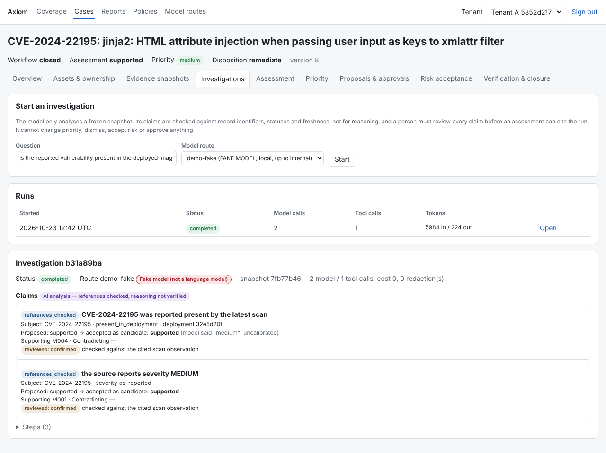
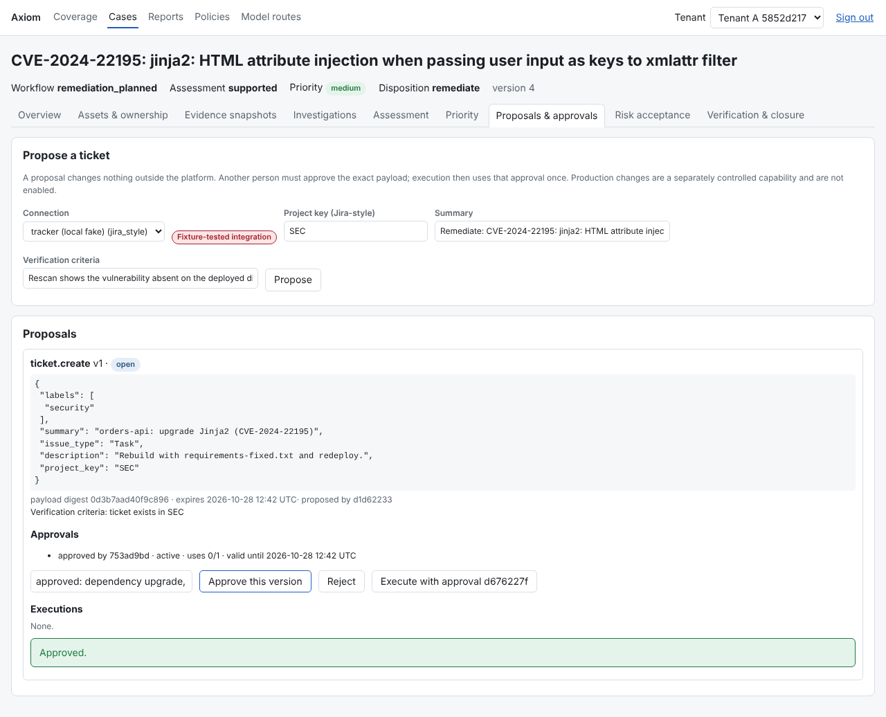
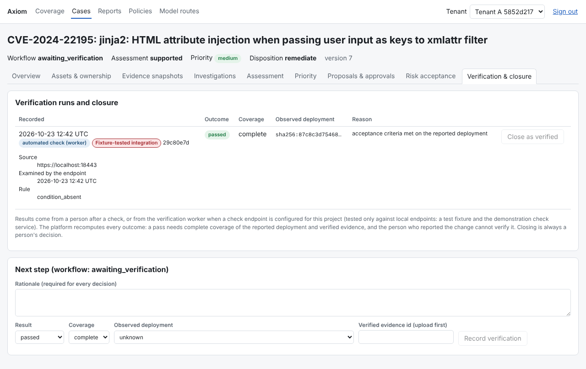
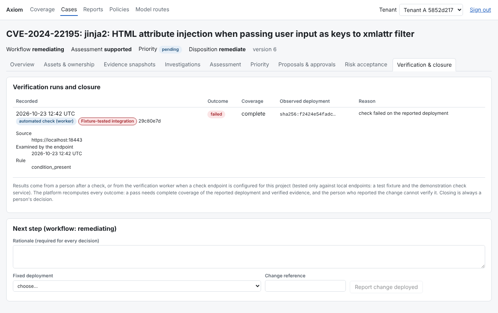

# Axiom

Evidence-backed vulnerability management platform: ingest findings, establish asset and business context,
investigate with deterministic checks and constrained AI, prioritise by versioned policy, coordinate approved
remediation, verify outcomes against the affected deployment, and report from recorded evidence. Supports a shared
multi-client installation and dedicated single-enterprise installations from one codebase.

**Status: work in progress; nothing here is production-ready.** The current state, with what is tested, what is
fixture-only, what is untested and the known limits, is in one place: `docs/IMPLEMENTATION_STATUS.md`, section
"Current status". In short: the foundation (tenant isolation, database roles, evidence storage, the case workflow),
ingestion, a durable job runner, the action and approval protocol, risk acceptance, policies, ownership, SLA clocks,
reporting and an analyst UI are built and tested; investigation runs only against a **deterministic fake model** (no
language model has been called); sign-in is tested **only against a local Keycloak**; integrations are at most
**fixture-tested**; the verification worker has been tested **only against local endpoints**.

## Why Axiom exists

Most vulnerability programmes run on two kinds of tool. A scanner dashboard lists findings, and a ticket workflow
tracks the work. Neither records why a finding was judged real or not, which deployment it applied to, who was
allowed to decide that, or whether the fix was ever checked on the thing that is actually running. Findings get
closed because a ticket was closed or because the next scan stopped reporting them, and when an auditor or an
incident asks "how do you know?", the answer is usually reconstructed after the fact. Adding a language model to
that loop makes it worse if the model's output can set priority or close work without anything checking it.

Axiom treats each finding as a case with a recorded history. The difference from a dashboard or a ticket queue is in
what the platform refuses to do, and most of that is built and tested today:

* A case is tied to a specific asset and deployment version. Results about a different deployment are not accepted
  as proof about this one.
* Every decision records who made it and the permission it relied on, and the history is append-only. People with
  the right role decide; system jobs can only record the narrow result types their own role permits.
* A case closes only through an explicit route: verified remediation, accepted risk, dismissal with supporting
  evidence, duplicate or asset retirement. These are reported separately. A scanner no longer reporting a finding
  never closes it, and neither does an external ticket being closed.
* Verification is recomputed by the platform. A pass needs the reported deployment, complete coverage and stored
  evidence whose digest has been verified. Anything missing or unavailable is inconclusive, never a pass.
* Actions such as creating a ticket need a human approval bound to the exact payload, and the authority behind it is
  checked again when the action runs.
* AI investigation runs on frozen evidence snapshots with read-only tools. Its claims are checked against recorded
  facts before anyone can cite them, and the model cannot set priority.

Some of this is design intent that has not been shown to work in practice yet:

* **AI usefulness is unmeasured.** No language model has been called. The investigation path runs against a
  deterministic fake. The claim checks are record checks (does the cited evidence exist, is it fresh, does it
  belong to this deployment); they do not judge whether a claim is semantically correct or relevant.
* **Nothing has met a real system.** Scanner and context connectors and ticket integrations are tested against
  fixtures and local fakes only. The verification worker has been tested against a test fixture and against the local
  demonstration service below. Sign-in has been tested against a local Keycloak only.
* **It is not production-ready.** It has not been deployed behind a real proxy, run at scale, or reviewed by an
  independent party. The evaluation labels were written by the author and still await independent review.

The documents under `docs/` record what was tested, how, and what was not.

## The demonstration: one finding from scan to verified closure

`docs/DEMO.md` walks one vulnerability through the whole workflow on one machine, and `scripts/demo/run.sh`
reproduces it in a few minutes (Docker, the test database, a local Keycloak and Chromium; no model, no hosted
tracker, no external service once images and the scanner database are cached). Two small services are built with
Jinja2 3.1.2, which has published advisories, and run from a local registry.

1. **Scan.** Trivy scans the image each service is running.
2. **Import and bind.** The reports go through the import API; each finding is bound to the image digest Docker reports
   for the running container.
3. **Investigate and prioritise.** An investigation runs through the model gateway with the deterministic fake; a
   second analyst reviews its claims; priority comes from a published policy.
4. **Approve and remediate.** A ticket proposal is approved in the browser by someone other than the proposer, then
   created in a local fake tracker. One service is rebuilt with Jinja2 3.1.6 and redeployed.
5. **Verify.** The verification worker asks a local check service, which rescans the running container with Trivy.
6. **Close and export.** A person closes the case in the browser; the case history and an auditor's evidence package
   are exported.

Two controls go through the same verification on the service that is never fixed: a change reported against the
unchanged deployment **fails**, and a fixed image that was built but not deployed is **inconclusive**.

| Part | Real or stand-in |
|---|---|
| Trivy scans, the image builds, the registry and the running containers | real, local; Trivy 0.76.1 with a cached database that changes daily |
| Axiom: API, database, workers, policies, verification worker, UI | real, from this repository |
| Investigation model | **deterministic fake**; no language model is called, and the UI labels it as a fake |
| Ticket tracker | **local fake**, in the test process |
| Check service that rescans the deployment | demonstration code in `scripts/demo`, not a supported component |

**What a verification pass means here.** The check service reports that, in a Trivy scan of the image the container
is running at that moment, the same vulnerability is no longer listed for the same package. Axiom accepts a pass only if
the answer is bound to this request, names the reported deployment, is recent, and covers every condition. It does not
show the vulnerable code was reachable or that other replicas were fixed, and it cannot detect a dishonest check
service: the result is the service's claim (docs/DEMO.md, "Who controls the endpoint"). Closing the case is still a
person's decision.

| | |
|---|---|
|  |  |
| Investigation with the fake model; a second analyst reviewed each claim. | Approval by someone other than the proposer; the tracker is a local fake. |
|  |  |
| The worker's pass for the redeployed digest, waiting for a person to close. | Control A: the same check fails on the deployment that was not changed. |

Screenshots from the run at `a05c01f` (provenance and checksums: `docs/demo/PROVENANCE.md`).

## Documents
* Start here: `docs/IMPLEMENTATION_STATUS.md` (current status), `docs/DEMO.md` (reproduction),
  `docs/INDEPENDENT-REVIEW.md` (how to review the trust boundaries and the evaluation labels)
* Design inputs: `docs/Axiom-Specification.md`, `...-Implementation-Plan.md`, `...-Data-and-Access-Design.md`
* Review of the supplied foundation: `docs/REVIEW-2026-10-22.md`
* Tracking: `docs/REQUIREMENTS.md`, `docs/IMPLEMENTATION_STATUS.md`, `docs/DECISIONS.md` and `docs/adr/`,
  `docs/VERIFICATION.md`, `docs/HANDOFF.md`
* Contributing: `CONTRIBUTING.md`

## Layout
```
backend/axiom/             API, auth, access control, domains (cases, risk, actions, evidence, assets, tenancy),
                           ingestion and adapters, job runner (axiom.jobs), verification worker, migrations
db/provision_roles.sql     cluster-level role provisioning (run once per cluster)
deployments/compose/       single-host install (PostgreSQL, SeaweedFS S3, init jobs, API, job worker)
scripts/dev/test-db.sh     disposable PostgreSQL cluster for tests
scripts/verify/            full verification and Compose smoke test
scripts/ci/run.sh          the CI pipeline (also run by .github/workflows/ci.yml on pull requests and main)
scripts/demo/              the local end-to-end demonstration (docs/DEMO.md)
tests/                     unit, PostgreSQL-backed integration tests, opt-in restore drills (tests/drills)
experiments/               workflow-engine experiments (not product code)
docs/design-inputs/        supplied foundation code kept for reference
```

## Fresh install from source (development)
Requirements: Linux, Python 3.13, uv 0.11+, PostgreSQL 16 server binaries (for tests), Docker with Compose v2+.
```
uv sync --frozen
scripts/dev/test-db.sh start            # disposable cluster on 127.0.0.1:55432, writes .env.test
uv run pytest tests -q                  # unit + PostgreSQL tests (S3 tests skip without an endpoint)
scripts/verify/foundation.sh            # full verification on a separate fresh cluster incl. S3 (needs Docker)
scripts/ci/run.sh                       # foundation + physical restore drill + Compose smoke (rebuilds the image)
```
Background work (ingestion runs, action executions, risk sweeps) runs in `python -m axiom.workers.jobs`. Set
`AXIOM_RESTORE_WITNESS` (`dir:/path` or `s3:bucket/prefix`, outside the database's backup domain) so restored or rolled
back databases are detected before any external effect is repeated (ADR 0010); production refuses to start without it.

## Compose (single host, synthetic data)
```
cp deployments/compose/.env.example deployments/compose/.env    # replace every value
docker build -t axiom-backend:dev .                           # behind a TLS proxy: --secret id=ca,src=<ca.pem> --network host
docker compose -f deployments/compose/compose.yaml --env-file deployments/compose/.env up -d
TOKEN=$(docker compose -f deployments/compose/compose.yaml --env-file deployments/compose/.env exec -T api \
        python -m axiom.devtools mint --dir /var/lib/axiom/dev-idp --sub alice)
curl -H "Authorization: Bearer $TOKEN" -H "X-Axiom-Tenant: demo" http://127.0.0.1:8000/api/v1/cases
```
The analyst UI is at `http://127.0.0.1:8000/ui/`; sign in on the local Keycloak page as a seeded user (for example
`alice`) with the password from `AXIOM_DEMO_PASSWORD`. Full procedure, configuration and what fails closed:
docs/INSTALL-COMPOSE.md. Seeded synthetic users and roles are listed in `backend/axiom/devseed.py`. Automated
check: `scripts/verify/compose-smoke.sh` (needs `uv sync` and Chromium for its browser step).

## Restoring from a preservation archive
See `docs/HANDOFF.md`, section "Restore".

## Security model in one paragraph
Tenant isolation combines application authorisation, composite tenant-aware foreign keys and forced PostgreSQL
row-level security with transaction-bound context. Runtime database identities never own tables and are never
superuser or BYPASSRLS; the API refuses to start otherwise. RLS is defence in depth: an attacker who fully controls the
application process can choose any tenant context, so tenants needing stronger separation belong on a dedicated
installation (ADR 0002).

## Known limits that matter before any deployment
* **The application database credential is a master key.** One runtime login serves every tenant. Whoever holds it
  can read and change any tenant's data, act as any user (including approving someone else's proposal) and attribute
  audit records to anyone. It cannot rewrite recorded history. Keep it as a mounted secret reachable only by the API
  and the workers; a tenant that needs stronger separation needs a dedicated installation (ADR 0012 amendment 4).
* **A verification endpoint can report false results.** Axiom binds each answer to the request, the asset and the
  reported deployment, but the result itself is the endpoint's claim. A dishonest or compromised endpoint can make
  Axiom record a false pass or a false failure. Closing a case stays a person's decision (docs/DEMO.md).
* **Suspending a tenant does not cancel its work.** A job running at that moment is left in state `running` until the
  tenant is reactivated; queued jobs wait. The recovery procedure is in docs/INSTALL-COMPOSE.md ("Suspending a
  tenant"). Cancellation of waiting work is not implemented.
